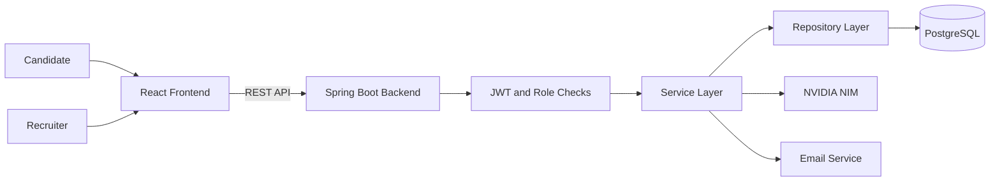

# JobGenius

**Smart Job Matching & AI-Powered Resume Analysis**

JobGenius is a full-stack job portal that connects candidates with relevant job opportunities and helps recruiters manage the hiring process. Candidates can compare their skills with job requirements, identify skill gaps, analyze their resumes, and track applications. Recruiters can publish jobs, review applicants, view ATS scores, and update application statuses.

## Features

### For candidates

- **Secure account access:** Register and log in using JWT authentication.
- **Profile and skills:** Manage profile information and add or remove skills.
- **Job discovery:** Browse, search, and filter job listings.
- **Job matching:** See match percentages and matched or missing skills for job requirements.
- **AI career insights:** Get personalized career tips based on a target role and skill gaps.
- **Resume management:** Upload, preview, download, select, and manage resumes (PDF, DOC, and DOCX; maximum 5 MB).
- **AI resume analyzer:** Evaluate a resume against a job, view an ATS score breakdown, and receive improvement recommendations.
- **Application tracking:** Apply for jobs, withdraw applications, and follow application status updates.

### For recruiters

- **Job management:** Create, edit, view, and delete job postings.
- **Applicant management:** View applicants for each job and access their submitted resumes.
- **ATS score visibility:** Review the ATS score saved with each application.
- **Hiring workflow:** Update application statuses such as `SCREENING`, `INTERVIEW`, `ACCEPTED`, and `REJECTED`.

### Email notifications

JobGenius sends HTML email notifications for registration, job applications, and application-status changes. Email delivery is designed to be non-blocking: notification failures are logged and do not interrupt the main user action.

## How job matching works

JobGenius compares a candidate's skills with the skills required for a job.

```text
Match Percentage = (Matched Skills / Total Required Job Skills) × 100
```

**Example:** A job requires Java, Spring Boot, PostgreSQL, and React. A candidate has Java, Spring Boot, and PostgreSQL.

```text
(3 matched skills / 4 required skills) × 100 = 75%
```

The candidate can see the three matched skills and identify React as a skill to improve.

## AI resume analysis and ATS scoring

The resume analyzer uses a hybrid scoring model. Backend logic calculates skill matching and resume strength, while NVIDIA NIM is used to assess experience and project relevance.

| Scoring component    |   Weight | Evaluation method           |
| -------------------- | -------: | --------------------------- |
| Skill match          |      60% | Backend skill comparison    |
| Experience relevance |      20% | NVIDIA NIM assessment       |
| Project relevance    |      10% | NVIDIA NIM assessment       |
| Resume strength      |      10% | Keyword-based backend logic |
| **Total**            | **100%** |                             |

The weights are configurable and must add up to 100.

The analyzer can return an overall score (0–100), component scores, extracted/matched/missing skills, experience in years (`0` means fresher), education, suggested roles, and recommendations. Recommendations are generated when the ATS score is below 90 and missing skills exist.

> The ATS score is an estimate intended to help candidates improve their resumes. It does not guarantee selection or represent the score used by every employer's applicant tracking system.

## Technology stack

| Layer          | Technologies                                     |
| -------------- | ------------------------------------------------ |
| Frontend       | React, Tailwind CSS, React Router, Axios         |
| Backend        | Java, Spring Boot, REST APIs, JWT authentication |
| Database       | PostgreSQL                                       |
| AI integration | NVIDIA NIM API — `meta/llama-3.1-8b-instruct`    |
| Email          | Spring Boot Mail, Gmail SMTP                     |

## Architecture



The backend follows a layered structure:

```text
Controller → Service → Repository → Database
```

The frontend uses reusable React components, a service layer for API calls, protected routes, and separate layouts for candidates and recruiters.

## Project structure

The following is the high-level structure of the application:

**Frontend**

```text
src/
├── components/
├── pages/
├── services/
├── hooks/
├── context/
├── routes/
├── layouts/
├── utils/
└── styles/
```

**Backend**

```text
src/main/java/com/jobmatcher/
├── controller/
├── service/
├── repository/
├── dto/
├── model/
├── config/
└── exception/
```

## Getting started

### Prerequisites

- Java JDK compatible with the backend project
- Maven (or the included Maven Wrapper)
- Node.js and npm
- PostgreSQL
- NVIDIA NIM API key (for AI features)
- Gmail app password (for email notifications)

### 1. Clone the repository

```bash
git clone <your-repository-url>
cd <repository-folder>
```

### 2. Create a PostgreSQL database

```sql
CREATE DATABASE jobgenius;
```

### 3. Configure the backend

In the backend `src/main/resources/application.properties`, configure your local database and service credentials. A template is provided below.

```properties
# PostgreSQL
spring.datasource.url=jdbc:postgresql://localhost:5432/jobgenius
spring.datasource.username=${DB_USERNAME}
spring.datasource.password=${DB_PASSWORD}

# JWT
jwt.secret=${JWT_SECRET}

# Gmail SMTP
spring.mail.host=smtp.gmail.com
spring.mail.port=587
spring.mail.username=${MAIL_USERNAME}
spring.mail.password=${MAIL_APP_PASSWORD}
spring.mail.properties.mail.smtp.auth=true
spring.mail.properties.mail.smtp.starttls.enable=true

# Frontend URL used in email links
app.frontend.url=http://localhost:5173

# NVIDIA NIM
nvidia.nim.api.key=${NVIDIA_NIM_API_KEY}
nvidia.nim.api.url=https://integrate.api.nvidia.com/v1/chat/completions
nvidia.nim.model=meta/llama-3.1-8b-instruct

# ATS scoring weights (must sum to 100)
ats.weight.skills=60
ats.weight.experience=20
ats.weight.projects=10
ats.weight.strength=10
```

Provide the referenced values (`DB_USERNAME`, `DB_PASSWORD`, `JWT_SECRET`, `MAIL_USERNAME`, `MAIL_APP_PASSWORD`, and `NVIDIA_NIM_API_KEY`) through your local environment or your deployment platform's secret configuration.

### 4. Run the backend

From the backend directory (where `pom.xml` is located):

```bash
mvn spring-boot:run
```

Or use the Maven Wrapper if it is included in the project:

```bash
# macOS / Linux
./mvnw spring-boot:run

# Windows PowerShell
.\mvnw.cmd spring-boot:run
```

The documented local API base URL is `http://localhost:8080/api`.

### 5. Configure and run the frontend

From the frontend directory (where `package.json` is located):

```bash
npm install
npm run dev
```

If the frontend reads `VITE_SERVER_DOMAIN` for its API base URL, set it in the frontend `.env` file:

```env
VITE_SERVER_DOMAIN=http://localhost:8080/api
```

Open **http://localhost:5173** in your browser.

## Main API modules

The backend exposes REST API modules for:

- Authentication and user profiles
- Job postings
- Candidate skills and job matching
- Job applications and application-status updates
- Resume upload and management
- AI career insights and resume analysis
- Job-type and work-mode enums

The API base URL for local development is `http://localhost:8080/api`.

## Database overview

The core database tables documented for JobGenius are:

`users` · `skills` · `user_skills` · `jobs` · `job_skills` · `applications` · `resumes`

## Security notes

- Never commit real database passwords, JWT secrets, Gmail app passwords, or NVIDIA API keys.
- Keep secret-bearing `.env` and configuration files out of version control.
- Use HTTPS and configure CORS appropriately when deploying.
- Enforce authorization in backend endpoints; frontend route protection alone is not sufficient.

---

**JobGenius — helping candidates find relevant opportunities, understand their skill gaps, and improve their resumes.**
